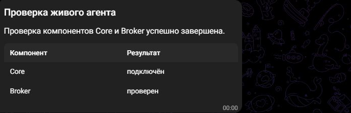

# Communication agent integration: partial acceptance, 2026-10-22

Issue #130, branch `codex/communication-agent-integration`, stacked on PR #128
(`a10b4b116f30d0ce2a590fbc6edb62cf902fce3a`). Web belongs to #129 and a separate
chat. Ordinary startup and production communication/autonomy defaults stay off.
This is scoped implementation evidence, not full AC01-AC22 acceptance.

## Implemented boundary

The opt-in disposable `*_test` App/Broker composition joins normal Input, Core,
Completion, exact Tool Broker dispatch, private communication control and the
main explicit Telegram adapter. The ordinary binaries still call their original
constructors. The profile offers message/photo/report, not widget/approval UX.

Verified Telegram ingress gets a private immutable epoch/proof in its owning
Input/Controller transaction (migration093); public payload fields cannot opt in.
New conversations use a bot/chat-derived canonical key. Replies use stored sent
ACKs, and owner controls use the existing Task Controller. A proven absent reply
target can be consumed with fixed clarification; generic guarded SQL/policy
failure preserves the cursor. Fixed service notices have pre-send durable claims
(migration094); unknown send/finish outcomes never trigger an automatic resend.
The verified numeric bot identity is pinned before admission/sending, preventing
another bot or recreated username from adopting a binding/backlog.

Current Catalog revision/access/deletion/dependency and per-binding export
policy are checked again for delivery and for each media artifact's source run.
Private export requires the exact operator `AllowPrivate` decision; secret or
revoked material remains denied. No allow-all policy is installed by the App.

## Provider authentication and routing

The owner's authorized refresh used the existing `cmd/provider-auth` utility and
normal Manager Resolve: expired before, OAuth HTTP200, encrypted refresh
persistence completed, not expired after, `unsafe_refresh=false`. No token/import
copy or modified expiry rule was used. The artificial ten-minute test rejection
was replaced with the normal one-minute margin. The runner now invokes this
maintenance before native execution under the shared operator auth lock and
checks current production work; inference reads the canonical encrypted row.
Only this normal credential renewal changed production state; no deployment,
configuration toggle or working container was changed.

Telegram reads an explicit private HTTP(S) proxy URL file. Model auth/discovery/
inference use the private `HTTPS_PROXY` environment reference, with external
hosts excluded from native `NO_PROXY`. Normal TLS verification and redirect
refusal remain enabled. The observer checks actual HTTP sockets, including reused
HTTP/2 connections; PostgreSQL and kernel loopback HTTP remain local. A separate
unauthenticated provider probe returned HTTP401 through the proxy with one
connection and zero denied-direct attempts. No auth or inference occurs in that
probe. Private reference files are cleaned after execution.

Core and the separately compiled native Broker now receive the same finite
budget policy. Their persisted scope limits are never replaced by process-local
defaults. The native fixture selects mode2 and resolves only its exact synthetic
approvals through the normal service. This does not qualify Telegram approval UX
or change production autonomy. The Broker's bounded fixture process lifetime now
covers the owning 300-second native scenario; synthetic defaults remain unchanged.

## Fresh validation

The Linux/PostgreSQL suite `communication-core-tests.sh --regression` passed:

- Required targeted race/process-crash matrices: 365 test/subtest passes, no
  failures or skipped required cases; vet passed.
- Regressions: 943 passes, no failures, 8 explicit environment skips.
- Shared private-control regression: 23 passes, no skips.
- All ordinary and isolated lab binaries built.

Final focused race/vet follow-up passed 59 test/subtest names without skips,
covering cursor rejection/storage boundaries, real cursor process death, current
owner controls (including resume/amend and immutable continuation proof), notices, bot identity and proxy routing. The full ready-catalog
matrix passed 10 names; an additional actual Core/Broker report publication
case passed. These are synthetic kernel/boundary evidence. Required tests never
perform native inference or actual channel sends.

Provider-auth, provider manager, transport and logical contract unit suites also
passed. A broad Windows selection hit the existing directory-sync limitation;
that failed run is not called green. Linux is the authoritative broad result.
Final branch CI/review status must be recorded from the published PR head.

## Accepted native window v20

`TestNativeCommunicationTelegramAgentIntegration` passed on the isolated server
on 2026-10-22 at 00:00 Asia/Tomsk (2026-10-21 17:00 UTC), in 34.73 seconds:

- Real Gemini 3.8 Flash High through the configured proxy, 8192 output ceiling,
  three actual model turns within the six-turn allowance.
- Actual private Broker process and current Catalog/export guards, two confirmed
  effects/publications: progress message and result report with a table.
- One internal final and completed run; no implicit final publication or extra
  outbox part. Telegram `sendMessage` ACK13 and `sendRichMessage` ACK14.
- Proxy trace: two connections opened, six HTTP uses, zero denied-direct attempts.
- Observed usage: 6784 input, 160 visible output, 9631 provider-total tokens.
  This total is not a monetary bill; it includes other provider dimensions.

Telegram Web displayed the exact title, summary and Core/Broker table. The
cropped image contains only that report, excluding the chat list:

The input is an operator-owned synthetic event through the verified ingress
composition. Delivery in this bounded fixture is drained after Core completion;
it does not prove early progress display while inference is still running.
Continuous `App.Run`, real user polling/response round trips, native quiet and
missing-response branches, joint Web semantics and actual client file opening
remain separate gates. Report/table rendering is not proof of semantic Task
completion, all clients/media limits or independent action verification.

Private proof root: `/srv/storage/butler/agents/communication-130-20261021`.
The disposable native PostgreSQL container and temporary private env/proxy files
were removed. Retained proof identities for v20:

| Artifact | SHA256 |
| --- | --- |
| Source archive | `8b46c03960c09a10e467c04c1be3b8a6f72175abf784145930b9f8bfe3491195` |
| Orchestrator test binary | `d6c2843ab537512f8b29d4c73bbea15d50d0b8cae28b0e8ad61e293a686aed5b` |
| Broker test binary | `a251db9573c0bfa67ae6527cd077059a5f52fbe959b013b17865bdaf1c70814d` |
| Provider-auth binary | `21e29fa0bad1869b09a79409b948f7b10bdec8e05ab0afc6f98acc45b8e81d4f` |
| Native log | `1a2bc66f45b8a9b482794fdc5c9bb2608a204bd7f20f26e5587f5be29e3a66c7` |

These identify the frozen accepted window, rather than implying that a screenshot
or an older native binary qualifies every later change. Subsequent proof-logging
and documentation edits retain unknown usage as null instead of presenting zero.

## Failed preparations and complete denominator

Earlier attempts are retained under distinct private `reports/native-*.log`
labels, not overwritten by the accepted run. They include network/address-pool/
permissions setup, direct Bot API timeout, missing wrapper inference limits,
undersized reservations, the read-only expiry guard, proxy trace confusion with
HTTP/2/PG, fixture Broker lifetime/catalog limits and mismatched Core/Broker budget
policies. The latter was a guarded dispatch rejection, not malformed model args;
no schema, authority or immutable budget check was relaxed to obtain a pass.

Across all retained native windows: 39 durable model-operation rows, 27 turns
with complete usage logs and 12 without a complete usage observation. The known
observed subtotal is 60872 input, 1966 visible output and 136288 provider-total
tokens, including the accepted window. Missing observations are unknown, not
free or zero billing. Old finite-ledger zero projections remain historical lower
bounds; the current helper explicitly reports observed/unknown counts and null
incomplete totals. The configured price basis is subscription/no overage; no
credit purchase, fallback model/account or automatic provider retry was used.
Only the accepted window sent its two Telegram parts.

Issue #130 remains open for the listed gates and final CI/review. PR #128 merge,
production enable and Web work require their separate decisions/evidence.
