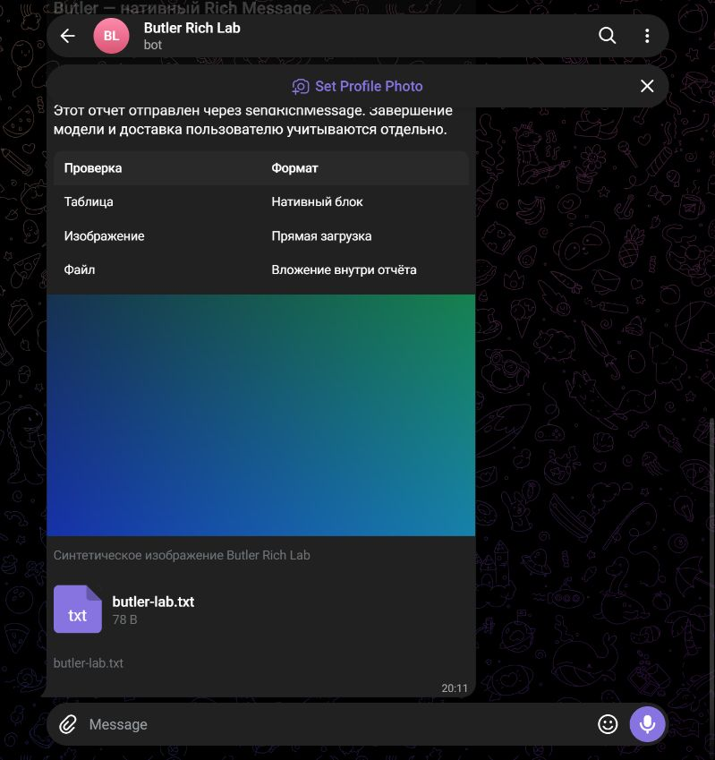
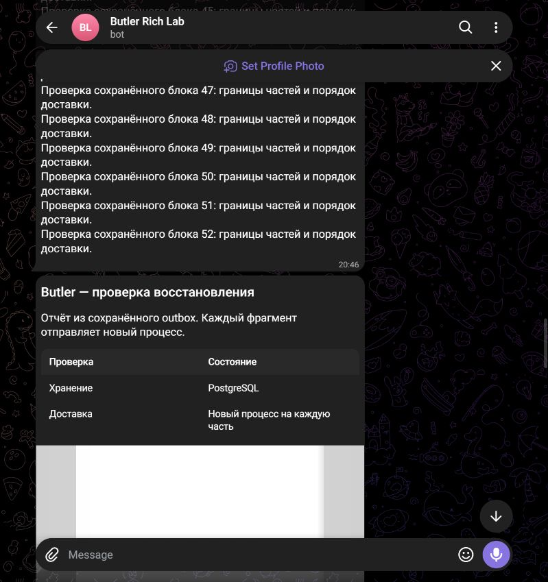

# #101/#102 scoped backend and Telegram acceptance

Baseline: merged PR #127, `d307a6c6a38e376bb56665cddb2c293b09538803`.
The owner explicitly retained the Web exclusion and authorized closing only
confirmed scope, transferring all remaining requirements. This accepts the
backend/Telegram implementation, not the complete original two-channel profile.
Web remains [#129](https://github.com/alex123321-maker/butler/issues/129); actual
App/Core/model composition and remaining user acceptance remain
[#130](https://github.com/alex123321-maker/butler/issues/130). Neither is passed
by closing the scoped originals. PR #128 retains source/CI/review evidence.

## Implemented scope

- Additive migration091 and retained owner/source-bound media in the existing
  Artifact Store. Read requires current policy, owning-session equality, privacy
  and content integrity. New saves require the actual owned run/session token.
- Transactional `PlanDelivery` freezes media/report parts in the existing outbox,
  with one canonical publication/transcript, deterministic part identity and
  individual ACKs. Missing required artifacts or failed planning rolls back all
  publication writes. No planner means photo/report admission remains denied.
- Separate `channel/telegramrich`, with plain message, photo and native
  `sendRichMessage` block mapping. Report splits at block boundaries, preserves
  tables/media/documents, refuses unknown blocks and silently discarded fields.
- Media is uploaded directly. Manifest pins reference/name/MIME/size/SHA-256;
  current media/claim/policy is rechecked immediately before the HTTP boundary.
- Exactly one HTTP attempt. Wrong/malformed/lost ACK, redirects and transport
  failure remain UNKNOWN; explicit rejection permits the existing bounded retry.
- Authenticated private owner reply normalization with current bot/user/chat and
  binding/version, stored ACK and canonical Input/Task Controller. No new task
  authority is inferred from message text or preference replies.
- Operator-only lab with fixed synthetic fixtures, expected test-bot username,
  explicit test chat and private token-file reference outside source.
- One canonical `communication_report` artifact, joined to publication/transcript/
  all parts transactionally; identity is derived from the publication, not a part.
- Explicit readiness (`Capabilities`): empty profile exposes no methods;
  report needs native rich/photo/document support without downgrade.
- PostgreSQL cursor (migration092) commits after canonical Input/control. Lost
  cursor commit replays stable update identity; unavailable/indeterminate denial
  retains the cursor. Inconsistent/out-of-order batches cannot partly execute.
- The main Telegram adapter exposes `NewExplicitAdapter` with mandatory owning
  store/guards/controller and matching bot/client/binding. It suppresses implicit
  final/status output and refuses mixed legacy rows. Bootstrap does not call it.

## Live channel evidence (2026-10-21)

Created a separate `@butler_rich_lab_20261021_bot` through official BotFather.
`getMe` verified the exact expected bot username. Token was transferred privately
to an operator file outside the repository, protected to the Windows owner;
no token, raw BotFather screenshot or credential URL is published here.

| Scenario | Observed evidence | Boundary |
| --- | --- | --- |
| Message | `sendMessage` ACK 2 | Native channel send |
| Photo introduction | `sendMessage` ACK 3 | Separate ordered caption-text part |
| Photo | `sendPhoto` ACK 4 | Generated PNG plus visible caption |
| Native report | `sendRichMessage` ACK 5 | Heading, summary, native table, PNG, text-file block |
| Client rendering | Telegram Web K accessibility tree contained heading/table/cells/photo/document and visual inspection confirmed the report | One client; not Web Butler renderer |
| Ordinary reply | Bot API update for owner message 6 contains `reply_to_message.message_id=5` | Correct native transport reply target |
| Document | `butler-lab.txt`, 78 B; Bot API download matched retained bytes and SHA-256 `359d9ab057e633d25df3c4cca373760a9d5c9ee27788a69501f08055193a3030` | Private `getFile` download verified; independent client opening remains #130 |
| Canonical report + process restart | 55 blocks saved as one canonical artifact and two outbox parts; native ACK 7/8 in the first run | Each part sent by a separate process exiting after its committed ACK |
| Main adapter composition | Repeated the new code path through `telegram.NewExplicitAdapter`, native ACK 9/10 | A new fixture/publication; not a replay of ACK 7/8 or model execution |
| Final persistence | Different typed internal final saved after those sends; publication/outbox count unchanged | No implicit duplicate report |

The browser's stale plugin path was repaired using a directory junction to the
installed Browser package and reconnecting its service. No Telegram session,
cookie or profile files were inspected. Existing bots were not changed.

## Validation and limitations

New HTTP/unit tests cover outcome classification, native multipart payloads,
deterministic block splitting, Unicode boundaries, missing authorization, media
replacement and revocation after reads. PostgreSQL scenarios cover atomic media
parts, restart, no replay after UNKNOWN, retained media owner/privacy/digest,
missing-required-attachment rollback, new adapter reply identity/deduplication/
canonical target and rollback refusal with retained history.
All seven report SQL write boundaries include lost storage-response rollback and
clean/lost-commit-ACK recovery: canonical report artifact and every part survive
together or none of them commits. Cursor tests cover the real Input-commit /
cursor-commit gap with failure and fresh poller, stable Input dedup, stale binding,
wrong bot, ambiguity, unavailable/indeterminate denial and ordered batches.
The native subprocess test above additionally proves real death/restart after
each external send and its durable ACK. It does not claim death at every cursor
instruction or actual provider behaviour; those unexecuted gates remain #130.

The required Linux/Go1.27.2/PostgreSQL17/race suite and regression script are
extended with artifacts and the new adapter, plus lab build. JSONL remains in
`.cache/communication-core` locally and is uploaded by the existing CI job.
Final counts/CI are recorded in the PR after completion; this file does not
substitute pending checks with a pass.

A broad Windows run was not a successful acceptance run: existing Catalog tests
cannot sync a directory on Windows, and some failed scenarios also failed their
fixture cleanup. The directory-sync error was reproduced on untouched baseline
`d307a6c6` with `TestCommunicationOwnerHTTPProofAndStrictBodiesIntegration`.
Linux is the supported environment for the complete fault matrices. Newly
selected adapter/artifact/media/reply checks also passed on Windows.

## Remaining work and status

#101 closes only its confirmed canonical media/outbox/Telegram/reply component
scope, after successful final CI/review. Web feed/detail/SSE/rendering and live
Web+Telegram fanout are #129. Default new-conversation/model admission and the
real model's early message -> tools -> final flow are #130. Programmatic polling
and durable cursor now exist, but are not installed in the normal application.
The lab is not model execution through Broker. Existing foundation tests retain
their own independently qualified kernel evidence.

#102 closes only canonical report storage and native Telegram mapping/parts/
readiness/retained-file component scope. Native multipart delivery after process
death and Bot API download/hash are verified above. Web renderer and complete
two-channel availability are #129; complete client-version/server-limit corpus,
independent Telegram client file-open and full rollout composition are #130/#107.
Widgets remain #104. No full AC01–AC22/product readiness is implied.

No production deployment, explicit-mode enable, Bootstrap registration or Web
change is included. The main Telegram adapter changes only through its explicit
constructor and guards; ordinary legacy behavior remains. No new dependencies.
Final review additionally covered shared-outbox isolation. The main explicit
adapter narrows its worker and owning sender guard to the exact bot binding
snapshot. A PostgreSQL fixture with Web and two bots sharing one chat proves
that foreign pending, expired sending and retry-exhausted rows remain intact;
direct authorization/finish also reject a different destination snapshot.
