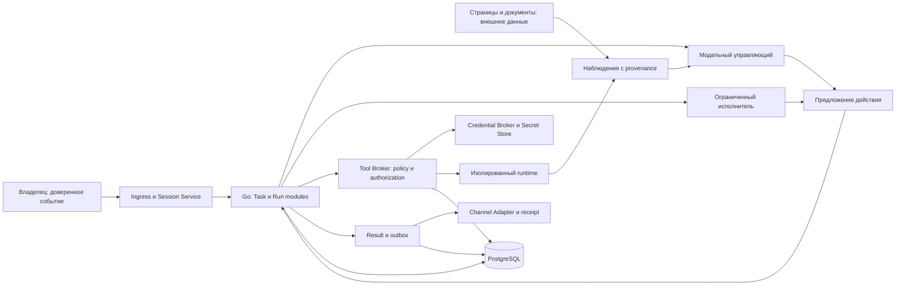

# Butler — постоянный личный помощник

Optional [deferred tool schemas](tool-discovery.md) expose current permitted capabilities through search and exact selection. Broker owns catalog authority; Orchestrator owns model context. Durable selection stays in PostgreSQL tool receipts and never grants additional task or delegated permissions.

Реализованный опциональный контракт [запланированных поручений](agent-schedules.md)
даёт агенту `schedule.*` через обычный Tool Broker. Принятое расписание переживает
завершение разговора; каждое срабатывание создаёт обычные Task/Input с актуальными
проверками полномочий. Простое напоминание использует доставку без вызова модели.
Общая целевая модель ниже не означает автоматического включения этой возможности.
После включения это стандартная возможность обычных сессий и задач, включая
существующие owner-goal мандаты без отдельного списка `schedule.*`. Явные запреты,
режим автономности, разрешённые эффекты, инициатива и бюджет сохраняются.

Версия 0.1, 2026-10-10. Продуктовый контракт для реализации issues #4–#33;
архитектурное решение issue #3. Это целевое поведение. Наличие определения здесь
не означает, что соответствующая таблица или операция уже реализована.

## Дополнение: явное общение

[User Communication](user-communication-spec.md) уточняет целевой продуктовый
контракт: агент публикует сообщения, фото, отчёты и вопросы инструментом;
model final сам по себе не отправляется. Все включённые каналы одного владельца
получают согласованные представления. Обязательство ответить, task verification
и доставка сохраняют разные состояния. Реализация следует отдельному
[плану](../planning/user-communication-roadmap.md).

## 1. Назначение и границы

Butler помогает одному владельцу вести работу неделями, проявлять полезную
инициативу в пределах выданных полномочий, делегировать отдельные исследования
и приобретать проверенные навыки. Разговор, поручение и запуск модели — разные
сущности. Обычный вопрос допускает прямой ответ без постоянного поручения.

Программное ядро на Go принимает события, проверяет версии и полномочия,
фиксирует эффекты и доставляет результаты. Модельный управляющий предлагает
планы, действия, делегирование и критерии проверки. Ограниченный исполнитель
получает конкретное задание, снимок контекста и подмножество полномочий.
Ни управляющий, ни исполнитель не выдают себе разрешения.

Все источники — Telegram, Web, расписания, уведомления инструментов, дочерние
результаты — проходят общий ingress. Внешнее содержимое имеет происхождение и
класс доверия; текст страницы, документа, навыка или дочернего отчёта не является
командой владельца. Любое изменение внешнего мира проходит Tool Broker даже
при единственном исполнителе.

Docker Compose, PostgreSQL, Redis и существующие сервисы остаются базовой
топологией. Новые владельцы состояния сначала реализуются явными модулями
в существующих сервисах. Распределённый планировщик и чужая агентная платформа
не являются обязательными зависимостями.

## 2. Сущности и единственный владелец состояния

Все долговечные записи ниже хранятся в PostgreSQL. pgvector — производный индекс,
Redis — сигнал пробуждения, ограниченный по времени кэш или аренда. Удаление Redis
не должно уничтожать принятое поручение, решение владельца или результат.

| Сущность | Смысл и обязательные данные | Логический владелец |
|---|---|---|
| Session | Идентичность, канал, владелец, порядок событий, текущая аренда и fencing epoch | Session Service |
| Input event | Идентификатор источника, actor, trust class, session sequence, receipt, привязка к поручению | Ingress вместе с Session Service |
| Task / поручение | Цель, источник, owner, статус, revision, constraints revision, критерии приёмки, result refs, parent | Task module оркестратора |
| Run | Одна попытка продвинуть поручение либо ответить в разговоре; task ref необязателен, pinned revision, бюджет, checkpoint | Run module оркестратора |
| Action | Конкретное намерение: task revision, tool/schema version, canonical args hash, target/resource, credential refs, effect state | Action journal Tool Broker |
| Authorization | Решение по точному действию, ограничения, authority version, expiry, revocation, одноразовость | Policy module Tool Broker |
| Approval | Запрос и решение владельца по action hash/revision; actor, expiry, audit и durable resume event | Approval module оркестратора |
| Observation | Результат чтения/действия, источник, время, observation/resource version, safe evidence refs | Transcript оркестратора / action journal Broker; runtime только поставляет данные |
| Result | Сохранённый пользовательский результат и evidence, completion verdict, artifact refs | Result module оркестратора |
| Delivery | Отдельная запись outbox по result/channel/recipient, попытки, receipt и last error | Channel delivery module |
| Goal | Постоянная цель владельца, область, актуальность, расписание проверки, budget refs | Goal module оркестратора |
| Mandate | Версионированные полномочия: действия, ресурсы, пределы затрат, срок, ограничения и отзыв | Policy module Tool Broker |
| Initiative | Предложение полезной работы с provenance, dedup key, оценкой и mandate ref | Goal/initiative module оркестратора |
| Delegation | Parent task/run, ограниченное задание, child task, capability subset, result receipt, budget reservation | Delegation module оркестратора |
| Extension / skill | Source, revision/digest, schemas, permissions, validation evidence, lifecycle, active version | Catalog module Tool Broker; содержимое — версия артефакта |

Физическая запись через модуль, которому принадлежит сущность, обязательна.
Другие компоненты используют его контракт и не обновляют чужие таблицы напрямую.
Credential metadata принадлежат Credential Broker, значения — Secret Store.
Ни одна сущность выше не содержит raw credential material в модельном контексте.

Граница между предложением и Broker — граница полномочий. Граница Broker/runtime
передаёт только ограниченную execution capability и отложенные secret references.
Секрет разрешается в доверенном системном пути после проверки policy, используется
в runtime и не возвращается в наблюдение. Модельный transport не владеет ни одной
долговечной продуктовой сущностью.

## 3. Режимы работы

| Режим | Когда нужен | Исполнение и проверка |
|---|---|---|
| Прямой ответ | Разговор, пояснение без внешнего эффекта | Один run; ответ сохраняется, доставка учитывается отдельно |
| Один исполнитель | Локальная последовательная задача | Task, один или несколько runs; эффект через Broker, проверка критерия |
| Независимое исследование | Несколько источников/гипотез можно изучать независимо | Ограниченные child tasks; общий бюджет и лимит глубины, parent проверяет evidence |
| Контролируемая процедура | Подготовить → исправить → согласовать → отправить | Durable checkpoints, exact-action approval, продолжение после перезапуска |
| Проверка результата | Важен внешний эффект или качество артефакта | Отдельное наблюдение/проверка; verdict связывается с task revision |

Многократное согласие моделей без независимых evidence не подтверждает результат.
Дочерний отчёт не завершает parent автоматически и не расширяет его полномочия.
Общий deadline, затраты и ресурсные аренды распространяются на дерево поручения.

## 4. Поручение, уточнение и завершение

Постоянное поручение, task-owned working state, multiple runs и owner-confirmed
completion реализованы в [Durable task implementation](durable-tasks-spec.md).
Durable ingress и восстановление описаны в [Durable Execution](durable-execution-spec.md),
точные разрешения и эффекты — в [Action Authorization](action-authorization-contract.md)
и [External Effect Journal](external-effect-journal.md), уточнения и отмена дерева —
в [Owner Controls](task-owner-controls-spec.md). Атомарный итог и отдельная доставка
следуют [Atomic Result Delivery](atomic-result-delivery.md). Постоянные цели,
делегирование и дальнейшие расширения остаются целевыми требованиями ниже.

Статусы поручения: `active`, `waiting_for_user`, `blocked`, `paused`, `cancelled`,
`completed`. Переход в `completed` требует сохранённого результата, verdict
по актуальным критериям и evidence refs. Завершение run со статусом `completed`
означает только окончание попытки. «Черновик готов, жду подтверждения» переводит
поручение в ожидание, сохраняя план и подготовленное действие.

Рабочая область принадлежит task и переживает runs и рестарт. Новое поручение
получает новую область; продолжение существующего требует explicit task ref либо
разрешения неоднозначности владельцем. История остаётся у session. Миграция старых
run-as-task записей сохраняет ссылки и помечает legacy completion как непроверенное;
переходная read API не должна выдавать старый final answer за проверенный эффект.

Уточнение увеличивает task/constraints revision. Активные ограничения сохраняются
отдельно от модельной сводки с source event ref. «Только черновики» отзывает более
широкое разрешение в этой области. Broker повторно проверяет revision/mandate перед
необратимым действием. Старое approval, план или результат требует перепроверки.
Отмена фиксируется программно, распространяется на детей и не зависит от того,
прочитала ли модель слово «стоп».

Пределы контекста расходуются сначала на текущий ввод, действующие ограничения
и несвёрнутые свежие события; затем на проверяемую сводку и второстепенные retrieval
материалы. Если обязательное не помещается, ядро останавливает исполнение с явной
причиной. Тихое удаление свежего запрета недопустимо.

## 5. Мандаты и инициатива

Владелец может выдать широкий мандат, например «поддерживай этот репозиторий,
создавай и тестируй изменения, публикуй PR». Мандат имеет owner, scope ресурсов,
разрешённые классы эффектов, лимит денег/времени/model calls, срок, версию и deny
ограничения. Широкая формулировка нормализуется в явный проверяемый scope;
неразрешённая неоднозначность не превращается в полномочие. Более узкий запрет
всегда ограничивает широкое разрешение. Mode 3 также исполняет policy.

Отзыв увеличивает authority version и блокирует новые эффекты во всём дереве.
Уже подтверждённый эффект не стирается из журнала; неизвестный эффект требует
наблюдения и reconciliation. Повтор mutating действия после timeout допускается
только при доказанной безопасности либо внешнем idempotency key.

Инициатива рождается из актуальной цели и наблюдения, проходит дедупликацию,
cooldown, budget admission и policy. В пределах мандата разрешено запустить работу;
за пределами — подготовить конкретное предложение владельцу. Расписание не даёт
прав на исполнение. Уведомления отправляются при полезном изменении, готовности,
сбое или требуемом решении; пустые проверки молчат. Timezone и missed-run policy
фиксируются в durable schedule.

Реализованные owner-goals, широкие мандаты и typed task assignment описаны в
[контракте целей и полномочий](owner-goals-mandates-spec.md). Подтверждённые
предпочтения/ограничения версионируют policy точного purpose. Отзыв сразу запрещает
новые authority commits, а durable job отдельно сообщает о фактическом завершении
отмены веток. Право подключения точного проверенного manifest не заменяет lifecycle
установщика; reporting policy не означает готовый планировщик отчётности.

## 6. Расширения, навыки и защитное ядро

Каталог хранит immutable версии, digest источника, совместимость схем, необходимые
capabilities, egress/resources, тестовые evidence и rollback target. Lifecycle:
`discovered → staged → validated → enabled → disabled/quarantined → removed`.
Skill — инструкция и ресурсы, tool — исполнимый контракт; оба являются внешним
содержимым, а не источником полномочий.

Выборочное автоматическое подключение разрешается только явным мандатом установки
для проверенных источников/версий, допустимых capabilities и ограниченного бюджета.
Изменение digest, схемы, зависимостей или requested permissions требует новой
проверки. Созданный агентом tool проходит независимые тесты в sandbox, через
обычное admission и только затем включается. Отсутствие installer mandate ведёт
к подготовленному предложению установки, а не к произвольному запуску кода.

Защитное ядро включает policy, credential mediation, action journal, fencing,
revocation, sandbox/egress и updater. Runtime/skill/управляющий не меняет его через
обычные tool capabilities. Изменение ядра проходит отдельный maintenance contract:
проверяемый diff, независимая проверка, fault-injection тесты, версия артефакта,
backup/rollback и явное разрешение владельца на изменение защитной политики.
Разрешение исправлять приложение само по себе не разрешает ослаблять policy.
Обнаружив неисправность, Butler может подготовить ремонт; диагностика не становится
root capability или прямым доступом к Docker socket.

## 7. Transport и память

WebSocket-first остаётся предпочтением при поддержке провайдером. Выбор модели
определяется качеством, capabilities, бюджетом и конфиденциальностью. REST/SSE
или локальная stateless модель сохраняют те же task/run semantics. Продолжение
provider session — оптимизация с проверяемой границей отправленного контекста.
Butler должен собрать корректный контекст даже после её потери или смены модели.

Transcript, Working, Episodic и Profile остаются четырьмя классами памяти.
Поручения, мандаты и approvals — операционное состояние, их нельзя восстанавливать
только семантическим поиском. Summary имеет source revision и последнюю покрытую
message sequence; обновление с более старой границей не перезаписывает новую.
Память хранит provenance, актуальность и правила отзыва/удаления; найденный текст
не равен разрешению. Общая локальная model service учитывает одновременно
загруженные веса, KV cache, workspace и concurrency; лимит контейнера сам по себе
не является планировщиком бюджета VRAM.

## 8. Что перенять из других проектов

Документация проверена 2026-10-10. Это сравнение механизмов, а не испытание моделей.
Каждая строка — проектное решение Butler; указанная стоимость — наша оценка.
Никакая строка не требует установки или миграции на рассматриваемую платформу.

| Источник и механизм | Решение | Польза | Стоимость сопровождения | Проверочный сценарий |
|---|---|---|---|---|
| [OpenClaw agent loop](https://docs.openclaw.ai/concepts/agent-loop): session serialization и writer claim | Адаптировать к PostgreSQL ordering и fencing epoch | Поздний worker не пишет поверх нового | Транзакционные проверки каждого checkpoint | Потеря аренды во время внешнего действия |
| [OpenClaw Lobster](https://docs.openclaw.ai/tools/lobster): pause/resume checkpoints | Перенять механизм; адаптировать хранилище и owner-bound approval | Процедура переживает ожидание человека | Версии checkpoint, expiry, миграции | Рестарт после создания approval и мгновенный ответ |
| Lobster: bearer resume token и локальные JSON файлы состояния | Не переносить как authority/store Butler | Сохраняет владельца и PostgreSQL truth | Собственный durable resume contract | Чужой actor с известным token не возобновляет действие |
| [OpenClaw subagents](https://docs.openclaw.ai/tools/subagents): isolated child context и result announce | Адаптировать | Независимые исследования без общей mutable памяти | Parent/child journal, бюджет, cancel tree | Дубликат child result учитывается один раз |
| [OpenClaw heartbeat](https://docs.openclaw.ai/gateway/heartbeat): scheduler-owned cadence и silent checks | Адаптировать | Проверки не засоряют канал | Dedup/cooldown, timezone, durable schedule | Несколько ticks без изменения дают ноль уведомлений |
| [Hermes Kanban](https://hermes-agent.nousresearch.com/docs/user-guide/features/kanban): durable task handoffs и completion contract | Перенять разделение task/run и evidence | Перезапуск не уничтожает цель | Task revisions и переходная миграция | Prepare → revise → approve → send остаётся одним task |
| Hermes: общий SQLite board и peer writes | Не переносить как модель владения Butler | Один владелец состояния и PostgreSQL | Контракты модулей вместо прямых записей | Child не меняет parent mandate/статус напрямую |
| [Hermes skills](https://hermes-agent.nousresearch.com/docs/user-guide/features/skills/): on-demand knowledge и bundles | Адаптировать | Меньше контекста, воспроизводимый навык | Digest, каталог, retrieval и rollback | Смена skill version не меняет уже pinned процедуру |
| Произвольная mutable skill directory как authority | Не переносить | Инструкция не получает права на действие | Immutable catalog versions и policy checks | Подмена файла не включает новые capabilities |

## 9. Приёмка и порядок реализации

Сначала устраняются небезопасные fallback и потери контекста. Затем вводятся task
и durable ingress (#4, #5), approvals/authorization/revocation (#6, #7, #9), action
journal/result outbox/budgets (#11–#13). На этой основе строятся цели, расписания,
делегирование и ресурсы (#14–#17), расширения и ремонт (#18–#21). Версии памяти
и corpus (#22, #23) предшествуют оценке retrieval/локальных моделей (#24–#30).
Security, UX и fault-injection (#31–#33) сопровождают каждый этап.

Обязательные сквозные проверки: новое B не наследует failed goal A; свежий запрет
переживает compaction и смену provider; рестарт после принятия ввода не теряет его;
fast approval не теряется; старый approval не разрешает новые args; lease loss
останавливает поздние записи; unknown effect не повторяется вслепую; сбой Telegram
не отменяет сохранённый result; отмена parent блокирует children; budget суммируется
по дереву; вредоносный skill не получает credential/egress capabilities.

Фактическая готовность каждой возможности подтверждается кодом, миграцией,
целевыми тестами и lab evidence в её issue. Документ закрывает проектное решение
#3, но не критерии реализации зависимых issues.

Durable acceptance and resumable owner approvals are described in
[Durable Execution](durable-execution-spec.md). Prepared context and task-owned
constraints are distinct from transient provider/Redis references; recovered
execution uses durable known results without replaying external tools.
