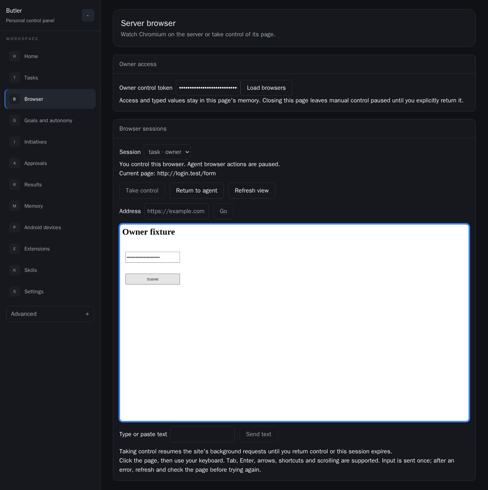

# Серверный браузер: реализация и проверка

Дата: 19 октября 2026. Runtime/UI исходники: commit `23292c3c` в
`codex/web-tools-audit`. Ветка включает актуальный `main` `57156dd5`, включая
параллельно реализованный tool discovery. Развёртывание общего Butler не менялось.

## Реализованное поведение

| Критерий | Реализация и проверка |
| --- | --- |
| Нет ограничения одним origin | `browser.read/open/navigate` revision3. Реальный Chromium проходит `start.test -> login.test` и загружает `cdn.test` в одном контексте. Native SOP/cookies/TLS и operator domain caps сохранены. |
| Просмотр в Web | `/browser`: текущий URL и JPEG viewport 1280x720, обновление примерно раз в 900 мс. Скриншот ниже получен из настоящего серверного Chromium. |
| Ручное управление | Явные Take control / Return to agent; клики, double-click на уровне протокола, прокрутка, клавиши, вставка текста и переход по URL. Web e2e вводит пароль в настоящую страницу и нажимает Submit. Независимый HTTP recipient считает ровно один дополнительный POST. |
| Исключён одновременный ввод | PG owner fence устанавливается до runtime RPC. Один runtime mutex сериализует владельца и агента; controller/epoch и одноразовый frame token проверяются до ввода. Старый кадр и старый takeover отклоняются. |
| Агент ждёт | Kernel ждёт перед inference admission, предложением инструмента и обработкой provider event. Broker проверяет fence до Claim/budget spend. Проверка подтверждает, что заблокированный grant остаётся `authorized`. |
| Безопасный возврат | После release нужна новая snapshot/extract. Старое предложение не отправляется. Потерянный release ACK оставляет PG fence закрытым; проверено явное восстановление новым takeover/release. |
| Секреты остаются приватными | Owner proof завершается в Core; runtime получает отдельный service token. Кадры/текущий URL удаляются из model result. Ввод, cookies, password fields и активные поля сохраняются только в памяти helper для маскирования отражённых значений. PG audit содержит operation/epoch/local ACK, без текста и пикселей. |
| `single_tab` вне стандарта | Все 15 legacy contracts имеют `status: disabled`. Проверены static registry и текущий run-scoped Broker catalog. Стандартная browser strategy не предлагает bind; legacy onboarding свёрнут в Settings. |
| Сохранён сетевой периметр | Private literals, metadata IP, IPv6 loopback, domain caps и freeze проверены отдельно. DNS/IP pinning, конечные byte/time budgets, запрет service workers/WebSockets сохранены. |



## Финальные проверки

Изолированный root: `/srv/storage/butler/agents/server-browser-20261019-a7f9`.
Финальный исполняемый snapshot: `snapshots/20261019-reviewed`; во время проверок
его исходники не менялись.

| Проверка | Результат |
| --- | --- |
| Linux Go unit/subtests с `-race`, узкие Core/prompt проверки | 276 pass events, 0 fail. 74 опциональных integration entrypoints пропущены в unit режиме; это не их acceptance. |
| `go vet` изменённых runtime/Broker/config/auth/Core пакетов | PASS, exit 0. |
| Реальный Chromium: `TestBrowserSessionE2E` | PASS, все 8 subtests: operator cap/private/POST/WS, заморозка delayed autosave, формы, credentials, stale DOM, expiry/crash, helper timer. |
| Реальный Chromium: `TestServerBrowserChromium` | PASS: redirect/CDN, реальный JPEG, ручные click/text/key, one-use frame, POST, masking, private destination refusal. |
| Web typecheck + ESLint + Stylelint | PASS. |
| Web production build и настоящий owner API/Broker/PG/Chromium e2e | PASS, 1/1 Playwright test и `TestServerBrowserBrokerIntegration`, без пропуска обязательных проверок. |
| Отдельный Web protocol/UI regression | PASS, 1/1: viewing/take/input/key/return, отказ ввода без автоматического повтора, отсутствие секретов в local/session storage. |

Web e2e использует production `ServerBrowser` handler и owner authentication в
отдельном test process, production Broker server/private HTTP/gRPC и настоящий PG
и Chromium. Run/task/lease и решения owner approval задаются изолированными
fixtures. Проверка не включает живого model provider, внешний аккаунт или полный
production bootstrap Core. Public DNS/dial для synthetic domains направлены в
тестовый loopback recipient исключительно через test-only seam; production не
содержит такого env bypass. Это не утверждение о совместимости со всеми сайтами.

В unit-команде отдельно исключён существовавший до этой работы
`TestFunctionCandidatePassesOrdinaryBrokerSchemaOnly`: его shadow-function pin
ожидает `doctor.check_system` revision1, тогда как исходный и текущий `main`
содержат revision2. Его исходный отказ не считается PASS и не относится к браузеру.

В процессе устранены реальные найденные дефекты: screenshot caret mutation
делала собственный кадр устаревшим; она отключена. Разделены Chromium caches
для Web Playwright1.58 и runtime Playwright1.52. Обновлён старый fixture navigation
revision2. Сохранены исходные FAIL/setup logs; итоговые PASS относятся к указанным
финальным журналам, а не к ранним попыткам.

## Воспроизведение и журналы

После синхронизации в собственный неизменяемый snapshot:

```sh
bash scripts/dev/server-browser-lab.sh "$owned_root" unit
bash scripts/dev/server-browser-lab.sh "$owned_root" browser
bash scripts/dev/server-browser-lab.sh "$owned_root" broker
bash scripts/dev/server-browser-lab.sh "$owned_root" web-real
```

Финальные журналы под указанным root:

- `reports/unit-20261019T054952Z-2806161.log` — unit/race и vet;
- `reports/browser-20261019T054946Z-2805604.log` — реальные браузерные regressions;
- `reports/web-real-20261019T054903Z-2802490.log` — production Web owner API -> Broker -> PG -> Chromium;
- `reports/web-20261019T055331Z-2823165.log` — отдельная UI/protocol проверка финальной версии;
- `reports/web-real-20261019T054626Z-2788229.log` — успешная проверка после объединения с `main`, до добавления отображения URL.

Локальные копии итоговых console logs в `.cache/server-browser/`:

| Файл | SHA256 |
| --- | --- |
| `unit-reviewed.log` | `2df6e8ba1e1cc6b1b1ef06f02635cfad16d741431395bf724efc85b8880ca7a3` |
| `browser-reviewed.log` | `a284550abf219b70ece1f786516c8a54adc25339fba19bd5098f7a0b3ff1f437` |
| `web-real-reviewed.log` | `20f34754a6482af2fb1d991d040b2b2a1146654738fdaea797eed8dc45824a34` |
| PNG выше | `465655ec7b0b1f817374aa71a30e2cb9fa195caa0c2588f856e370a884c430fc` |

Go image: `sha256:5cf287a799e6b94384bad13d16b14904c531f51ba65792237e122ce42b392f61`.
Browser image: `sha256:3a2e719f086e2d2a110a79f817f235518350aaf87ea47cb51a9a75158e32d9c6`.
PG image: `sha256:ac08538c6f8b9904c33c8224c5e5706dbe760aca29db1d096972b4052c22a75d`.

## Изоляция, подключение и границы

Только собственные caches/fixtures/PG directories, finite resource limits и
root-local flock. Shared module/browser caches монтируются read-only. PG работает
с `network none`; остальные acceptance процессы используют его частный network
namespace. Host ports не публикуются. Созданные PG containers удалены по точному
собственному имени. Compose общего стека не запускался и не перезапускался.
Основной `D:\Repository\butler` остался чистым на `405a096b`; новая работа и merge
`main` находятся только в отдельном worktree.

Для будущего подключения нужны migration086, существующий owner-control proof и
`deploy/docker-compose.server-browser.yml` с отдельным browser-control token file.
Broker отказывается стартовать без схемы или при совпадении runtime token с core
authority token. Этот overlay в общий deployment не применялся.

Остаются явные границы: одна страница/viewport в контексте, 15 минут и максимум
32 контекста, закрытие popups, запрет WebSockets/service workers/downloads.
Popup-only SSO, native Chrome desktop controls, file uploads и полноценный OS
remote desktop не реализованы. Начатый до takeover inference нельзя отменить
задним числом. Пропавший runtime не восстанавливает страницу; потерянное
подтверждение не даёт автоматического повтора или возврата агенту.
